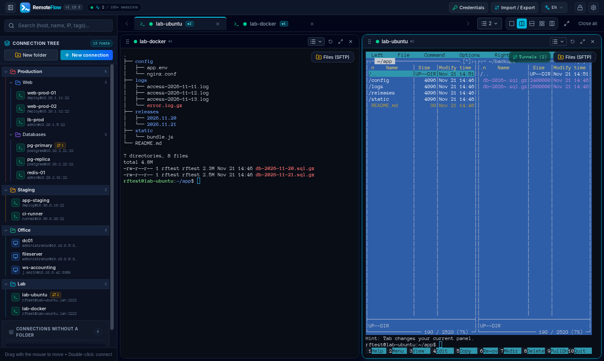
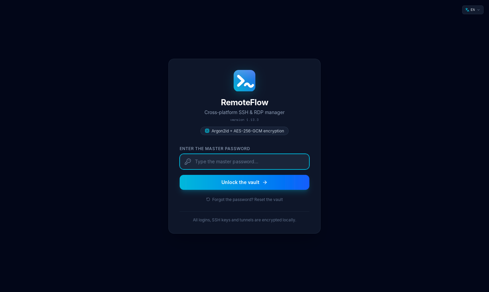

# RemoteFlow

**English** | [Polski](README.pl.md)

RemoteFlow is a cross-platform **SSH, SFTP and RDP connection manager** for Windows and Linux, inspired by mRemoteNG.
All connections, passwords and keys are kept in a local, encrypted vault. The app is built with
**Tauri 2 + Rust** (backend) and **React 19 + TypeScript** (UI).



## Features

### Connections and workspace
- Polish and English user interface – switch the language in the header, on the login screen or in Settings (applied instantly).
- Dark or light theme (Settings), optionally with a dark terminal in the light theme.
- Connection tree with nested folders, colours, search (name, host, IP, tags) and drag & drop.
- Tabs and split-screen layouts: single, horizontal, vertical, 3 columns and 2×2 grid.
- Reusable credential profiles shared by many connections.
- Optional confirmations before closing connections and the application (configurable).

### SSH
- Built-in terminal (xterm.js) with a full 16-colour palette – `mc`, `htop` and similar tools render correctly.
- Authentication with password, private key (with optional passphrase prompt), certificate or SSH agent.
- Port forwarding: local, remote and dynamic (SOCKS5).
- Copy/paste from the context menu and keyboard, middle-click paste of the terminal selection.
- Server host keys verified on first use (TOFU) – the password is sent only to a trusted server.

### SFTP – two-pane file manager
- Local files on the left, server files on the right (WinSCP / FileZilla style); takes half of the pane, or the whole pane in split layouts.
- Multi-selection (click, Ctrl, Shift, Ctrl+A) and one-click upload / download of files and whole folders.
- Drag & drop between the panes, onto folders and from the system file manager.
- Filtering and recursive search on both sides, creating folders on both sides, deleting on the server.
- Progress in the status bar, overwrite confirmation, right-click context menu.
- Start folders saved per connection (local and server); by default the home folders are opened.

### RDP
- Embedded RDP client (IronRDP compiled to WebAssembly) through a local proxy – the resolution automatically follows the window size.
- TLS with certificate pinning; automatic fallback to the system TLS stack (Schannel / OpenSSL) for older servers such as Windows Server 2012.
- Domain accounts: `user` + domain field, `DOMAIN\user`, UPN `user@domain.local` or `.\account` for a local account – normalised the same way for the embedded client, FreeRDP and mstsc.
- Text clipboard in both directions. On Windows, files copied in the remote session can be pasted directly in Explorer (and vice versa); on Linux files are exchanged through a shared folder.
- Linux: optional **FreeRDP inside the app window** (Settings → RDP client) – the native client (multi-threaded, H.264) draws the session in the RemoteFlow tab; requires X11 (on Wayland the app then runs through XWayland) and `xfreerdp3`.
- Performance statistics panel in the RDP view (data rate, screen updates, drawing time, main-thread load).
- Optional launch of the system client (`mstsc` on Windows, FreeRDP on Linux – started with the graphics pipeline `/gfx` and `/network:auto`; faster than the embedded client for video or heavy scrolling).

### Security
- Vault encrypted with **AES-256-GCM**, key derived from the Master Password with **Argon2id**.
- Format v3 also encrypts connection names, addresses, users, notes, groups and trusted server identities. The authenticated public header retains unlock, interface and backup settings. Older vaults are backed up and migrated after a successful unlock; existing backups keep their original format. Use version 1.6.1 or newer to open a v3 vault.
- **HMAC-SHA256** integrity check of the whole vault file – modifications made outside the app are detected.
- Quick unlock with a PIN (the master key wrapped by the PIN exists only in memory).
- Automatic lock after inactivity and when the operating system is locked (Windows, Linux logind / ScreenSaver).
- Periodic vault backups, restore from Settings.
- Encrypted export / import of the vault.
- FreeRDP certificate conflicts show the current SHA-256 fingerprint for verification and explicit approval. Reconnecting uses that exact fingerprint without disabling certificate checks or deleting the shared FreeRDP certificate cache.



### Import from mRemoteNG
- Imports `confCons.xml` together with folders and **passwords** (AES-GCM and legacy AES-CBC, also fully encrypted files).
  Passwords are decrypted only in the Rust backend and immediately re-encrypted with the vault key.

## Download

Ready-made builds are published on the [Releases](https://github.com/jacek-nikiel/RemoteFlow/releases) page (when available).
Requirements: Windows 10/11 x64 (WebView2 is included in the system) or a Linux distribution with WebKitGTK 4.1.

Linux: if the window flickers, stays blank or the console shows `DRM_IOCTL_MODE_CREATE_DUMB failed` / `Failed to create GBM buffer`, switch *Settings → Colour theme → Window rendering (Linux)* to *Compatible* (or start once with `REMOTEFLOW_SAFE_RENDERING=1 remoteflow`).

## Building from source

### Requirements
- [Node.js](https://nodejs.org/) **20.19+ or 22.12+** (required by Vite 8)
- [Rust](https://rustup.rs/) (stable, edition 2024 support)
- Windows: Visual Studio C++ Build Tools (offered by the Rust installer)
- Linux (Debian/Ubuntu):
  ```bash
  sudo apt install build-essential pkg-config file patchelf libssl-dev libwebkit2gtk-4.1-dev libgtk-3-dev libsoup-3.0-dev libjavascriptcoregtk-4.1-dev librsvg2-dev libayatana-appindicator3-dev libxdo-dev
  ```

### Commands
```bash
npm install
npm run tauri dev      # development mode
npm run tauri build    # release build + installers
```
Output:
- Windows – `src-tauri/target/release/remoteflow.exe`, installers in `src-tauri/target/release/bundle/nsis` and `bundle/msi`
- Linux – `src-tauri/target/release/remoteflow`, packages in `src-tauri/target/release/bundle/` (`.deb`, `.rpm`, `.AppImage`)

On Windows you can also use `run-windows.bat` (development mode) and `build-windows.bat` (release build).

### Linux build in Docker (also from Windows)
```bash
docker build -f docker/Dockerfile.linux --target export --output type=local,dest=dist-linux .
```
or simply run `build-linux-docker.bat` on Windows. The packages land in `dist-linux/`.

### Tests
```bash
node scripts/check-i18n.mjs   # every UI text has an English translation
cd src-tauri
cargo test --lib              # unit tests
cargo test --lib -- --ignored # integration tests (require local SSH/RDP test servers)
```
Linux compilation and unit tests can also run on Windows through Docker:
```bash
docker build -f docker/Dockerfile.linux --target verify .
```

## Where is my data?
The vault (`vault.json`) is stored next to the executable (portable mode) when that folder is writable,
otherwise in the user configuration directory (`%APPDATA%\remoteflow` on Windows, `~/.config/remoteflow` on Linux).
Backups are kept in the `backups` folder next to the vault. 

## Technology stack
| Layer | Technologies |
|---|---|
| Application shell | Tauri 2, WebView2 (Windows) / WebKitGTK (Linux) |
| Backend | Rust 2024, tokio, ssh2 (libssh2), rustls + native-tls, tokio-tungstenite, ironrdp-rdcleanpath |
| Cryptography | argon2, aes-gcm, hmac + sha2, zeroize |
| UI | React 19, TypeScript, Vite 8, Tailwind CSS 4, lucide-react |
| Terminal / RDP | xterm.js 6, IronRDP (WebAssembly) |
| Platform | clipboard-win (Windows), zbus / GTK (Linux) |

## Versioning
The project uses [semantic versioning](https://semver.org/). Every change increases at least the patch number –
see [CHANGELOG.md](CHANGELOG.md). The version is kept in `package.json`, `src-tauri/tauri.conf.json` and
`src-tauri/Cargo.toml` (a unit test checks that they match) and is shown next to the logo and on the login screen.

## License
[MIT](LICENSE) © 2026 Jacek Nikiel
