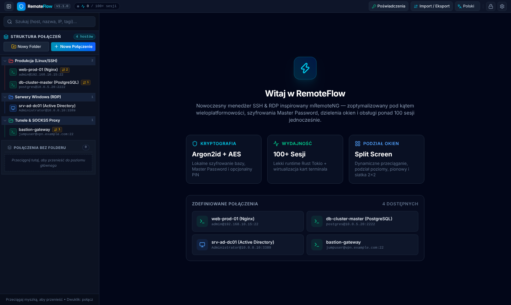
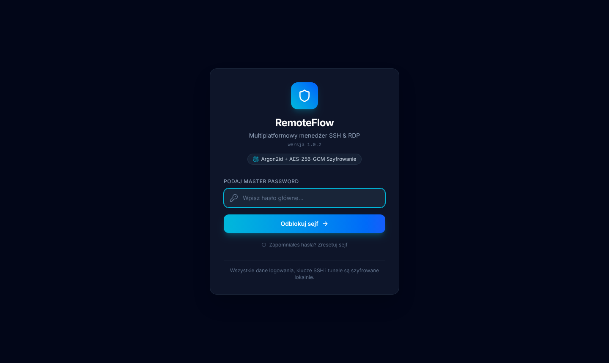

# RemoteFlow

[English](README.md) | **Polski**

RemoteFlow to wieloplatformowy **menedżer połączeń SSH, SFTP i RDP** dla systemów Windows i Linux, inspirowany mRemoteNG.
Wszystkie połączenia, hasła i klucze są przechowywane w lokalnym, zaszyfrowanym sejfie. Aplikacja jest zbudowana w oparciu o
**Tauri 2 + Rust** (backend) oraz **React 19 + TypeScript** (interfejs).



## Funkcje

### Połączenia i obszar roboczy
- Interfejs po polsku i angielsku – zmiana języka w nagłówku, na ekranie logowania lub w Ustawieniach (działa od razu).
- Ciemny lub jasny motyw (Ustawienia), opcjonalnie z ciemnym terminalem w jasnym motywie.
- Drzewo połączeń z zagnieżdżonymi folderami, kolorami, wyszukiwaniem (nazwa, host, IP, tagi) i przeciąganiem.
- Zakładki i podział ekranu: pojedynczy, poziomy, pionowy, 3 kolumny i siatka 2×2.
- Wspólne profile poświadczeń używane przez wiele połączeń.
- Opcjonalne potwierdzenia przy zamykaniu połączeń i programu (do wyłączenia w Ustawieniach).

### SSH
- Wbudowany terminal (xterm.js) z pełną paletą 16 kolorów – `mc`, `htop` i podobne narzędzia wyświetlają się poprawnie.
- Uwierzytelnianie hasłem, kluczem prywatnym (z opcjonalnym pytaniem o hasło klucza), certyfikatem lub agentem SSH.
- Przekierowanie portów: lokalne, zdalne i dynamiczne (SOCKS5).
- Kopiowanie i wklejanie z menu kontekstowego i klawiatury, wklejanie zaznaczenia środkowym przyciskiem myszy.
- Weryfikacja klucza serwera przy pierwszym połączeniu (TOFU) – hasło jest wysyłane tylko do zaufanego serwera.

### SFTP – dwupanelowy menedżer plików
- Pliki lokalne po lewej, pliki serwera po prawej (jak w WinSCP / FileZilla); okno zajmuje połowę panelu, a przy podzielonym ekranie cały panel.
- Zaznaczanie wielu elementów (klik, Ctrl, Shift, Ctrl+A) i wysyłanie / pobieranie plików oraz całych katalogów jednym kliknięciem.
- Przeciąganie między panelami, na katalogi oraz z systemowego menedżera plików.
- Filtrowanie i wyszukiwanie w podkatalogach po obu stronach, tworzenie katalogów po obu stronach, usuwanie na serwerze.
- Postęp na pasku stanu, pytanie o nadpisanie, menu pod prawym przyciskiem myszy.
- Katalogi startowe zapamiętywane osobno dla każdego połączenia (lokalny i na serwerze); domyślnie otwierane są katalogi domowe.

### RDP
- Wbudowany klient RDP (IronRDP skompilowany do WebAssembly) działający przez lokalne proxy – rozdzielczość automatycznie dopasowuje się do okna.
- TLS z przypinaniem certyfikatu; automatyczne przejście na systemowy stos TLS (Schannel / OpenSSL) dla starszych serwerów, np. Windows Server 2012.
- Konta domenowe: `użytkownik` + pole „Domena”, `DOMENA\użytkownik`, UPN `użytkownik@domena.local` lub `.\konto` dla konta lokalnego – tak samo dla wbudowanego klienta, FreeRDP i mstsc.
- Schowek tekstowy w obie strony. Na Windows pliki skopiowane w sesji zdalnej można od razu wkleić w Eksploratorze (i odwrotnie); na Linuksie pliki są wymieniane przez folder współdzielony.
- Opcjonalne uruchomienie systemowego klienta (`mstsc` na Windows, FreeRDP na Linuksie – z potokiem graficznym `/gfx` i `/network:auto`; szybszy od wbudowanego klienta przy wideo lub intensywnym przewijaniu).

### Bezpieczeństwo
- Sejf szyfrowany **AES-256-GCM**, klucz wyprowadzany z Master Password algorytmem **Argon2id**.
- Kontrola integralności całego pliku sejfu **HMAC-SHA256** – zmiany wprowadzone poza aplikacją są wykrywane.
- Szybkie odblokowanie kodem PIN (klucz główny zabezpieczony PIN-em istnieje wyłącznie w pamięci).
- Automatyczna blokada po bezczynności i po zablokowaniu systemu operacyjnego (Windows, Linux logind / ScreenSaver).
- Okresowe kopie zapasowe sejfu i przywracanie z Ustawień.
- Szyfrowany eksport i import sejfu.



### Import z mRemoteNG
- Import pliku `confCons.xml` razem z folderami i **hasłami** (AES-GCM i starszy AES-CBC, także pliki w pełni zaszyfrowane).
  Hasła są odszyfrowywane wyłącznie w backendzie Rust i od razu szyfrowane kluczem sejfu.

## Pobieranie

Gotowe wersje są publikowane na stronie [Releases](https://github.com/jacek-nikiel/RemoteFlow/releases) (gdy będą dostępne).
Wymagania: Windows 10/11 x64 (WebView2 jest wbudowany w system) lub dystrybucja Linuksa z WebKitGTK 4.1.

Linux: jeśli okno miga, jest puste albo w konsoli pojawia się `DRM_IOCTL_MODE_CREATE_DUMB failed` / `Failed to create GBM buffer`, przełącz *Ustawienia → Motyw kolorystyczny → Renderowanie okna (Linux)* na *Zgodne* (albo uruchom raz `REMOTEFLOW_SAFE_RENDERING=1 remoteflow`).

## Budowanie ze źródeł

### Wymagania
- [Node.js](https://nodejs.org/) **20.19+ lub 22.12+** (wymagane przez Vite 8)
- [Rust](https://rustup.rs/) (stabilny, z obsługą edycji 2024)
- Windows: Visual Studio C++ Build Tools (instalator Rusta proponuje ich instalację)
- Linux (Debian/Ubuntu):
  ```bash
  sudo apt install build-essential pkg-config file patchelf libssl-dev libwebkit2gtk-4.1-dev libgtk-3-dev libsoup-3.0-dev libjavascriptcoregtk-4.1-dev librsvg2-dev libayatana-appindicator3-dev libxdo-dev
  ```

### Polecenia
```bash
npm install
npm run tauri dev      # tryb deweloperski
npm run tauri build    # wersja produkcyjna + instalatory
```
Wynik:
- Windows – `src-tauri/target/release/remoteflow.exe`, instalatory w `src-tauri/target/release/bundle/nsis` i `bundle/msi`
- Linux – `src-tauri/target/release/remoteflow`, pakiety w `src-tauri/target/release/bundle/` (`.deb`, `.rpm`, `.AppImage`)

Na Windows można też użyć `run-windows.bat` (tryb deweloperski) i `build-windows.bat` (wersja produkcyjna).

### Wersja Linux w Dockerze (także z Windows)
```bash
docker build -f docker/Dockerfile.linux --target export --output type=local,dest=dist-linux .
```
albo po prostu uruchom `build-linux-docker.bat` na Windows. Pakiety trafią do folderu `dist-linux/`.

### Testy
```bash
node scripts/check-i18n.mjs   # każdy tekst interfejsu ma tłumaczenie angielskie
cd src-tauri
cargo test --lib              # testy jednostkowe
cargo test --lib -- --ignored # testy integracyjne (wymagają lokalnych serwerów testowych SSH/RDP)
```

## Gdzie są moje dane?
Sejf (`vault.json`) jest zapisywany obok pliku programu (tryb przenośny), jeśli ten folder jest zapisywalny,
w przeciwnym razie w katalogu konfiguracji użytkownika (`%APPDATA%\remoteflow` na Windows, `~/.config/remoteflow` na Linuksie).
Kopie zapasowe trafiają do folderu `backups` obok sejfu. **Nigdy nie umieszczaj `vault.json` w repozytorium** – plik jest wykluczony w `.gitignore`.

## Stos technologiczny
| Warstwa | Technologie |
|---|---|
| Powłoka aplikacji | Tauri 2, WebView2 (Windows) / WebKitGTK (Linux) |
| Backend | Rust 2024, tokio, ssh2 (libssh2), rustls + native-tls, tokio-tungstenite, ironrdp-rdcleanpath |
| Kryptografia | argon2, aes-gcm, hmac + sha2, zeroize |
| Interfejs | React 19, TypeScript, Vite 8, Tailwind CSS 4, lucide-react |
| Terminal / RDP | xterm.js 6, IronRDP (WebAssembly) |
| Zależne od systemu | clipboard-win (Windows), zbus / GTK (Linux) |

## Wersjonowanie
Projekt stosuje [wersjonowanie semantyczne](https://semver.org/lang/pl/). Każda zmiana podnosi co najmniej numer poprawki –
zobacz [CHANGELOG.md](CHANGELOG.md). Wersja jest zapisana w `package.json`, `src-tauri/tauri.conf.json` i
`src-tauri/Cargo.toml` (test jednostkowy sprawdza ich zgodność) i jest wyświetlana obok logo oraz na ekranie logowania.

## Licencja
[MIT](LICENSE) © 2026 Jacek Nikiel
